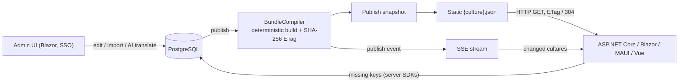

<div align="center">

# MASA.Lingua

**A lightweight i18n platform: manage translations centrally, ship them as static JSON bundles, and hot-update every client over SSE.**

[](LICENSE)
[](https://github.com/masastack/MASA.Lingua/actions/workflows/pr_run_test_ci.yml)
[](https://www.nuget.org/packages/MASA.Lingua.Core/)
[](global.json)

[English](README.md) | [简体中文](README.zh-CN.md)

</div>

---

MASA.Lingua is a translation management platform plus a set of client SDKs. Editors work in a Blazor admin UI (with optional AI-assisted translation); clients — ASP.NET Core, Blazor, MAUI, and Vue 3 apps — consume published translation bundles through plain HTTP with strong ETags, and receive publish notifications over Server-Sent Events.

No runtime dependencies on the platform: after startup, clients read versioned static JSON from disk-level caching. If the Lingua server is briefly unavailable, your app keeps rendering the translations it already has.

## Features

- **Static bundles with strong ETags** — publishing produces immutable `{culture}.json` files served with `ETag` + `Cache-Control: no-cache`; unchanged requests get `304`. No stale caches, no extra publish-to-client latency.
- **Hot updates over SSE** — every publish event carries `projectCode`, per-culture ETags and `versionHash`; clients skip unchanged cultures and reconcile on a fixed idle interval even if an event is missed.
- **Layered fallback** — global shared namespaces (`common` / `errors`) merge with per-project namespaces; unpublished translations fall back to the source culture.
- **AI-assisted translation** — batch translation through [Microsoft.Extensions.AI](https://learn.microsoft.com/dotnet/ai/conceptual-overview) (any OpenAI-compatible endpoint, e.g. local Ollama), with deterministic validation before results are accepted.
- **Glossary enforcement** — mandatory terms are validated on entry and at publish time, with compliance reporting.
- **Deterministic publishing** — bundle bytes and ETags are reproducible: the same input always yields the same output, and a server restart restores published bundles byte-for-byte from database snapshots.
- **Missing-key telemetry** — server-side SDKs report missing keys back to the platform (authenticated with project write keys).
- **Multi-end SDKs** — `IStringLocalizer` for ASP.NET Core, `I18n.T` bridge for MASA Framework, `T()` for Masa.Blazor, hot-reloading localizer for .NET MAUI, and a Vue 3 adapter with a `lingua-sync` CLI for build-time pulls, imports and CI checks.

## How it works



## Packages

| Package | Target | Description |
|---|---|---|
| [`MASA.Lingua.Core`](https://www.nuget.org/packages/MASA.Lingua.Core/) | net8.0 / net10.0 | Domain model, bundle compiler, JSON converter, deterministic validation engine |
| [`MASA.Lingua.SDK.Abstractions`](https://www.nuget.org/packages/MASA.Lingua.SDK.Abstractions/) | net8.0 / net10.0 | Client contracts, frozen memory store, sync protocol |
| [`MASA.Lingua.SDK.AspNetCore`](https://www.nuget.org/packages/MASA.Lingua.SDK.AspNetCore/) | net8.0 / net10.0 | `IStringLocalizer` adapter backed by `{culture}.json`, SSE + polling hot reload |
| [`MASA.Lingua.SDK.MasaI18n`](https://www.nuget.org/packages/MASA.Lingua.SDK.MasaI18n/) | net8.0 / net10.0 | Bridge into MASA Framework `I18n.T` / `II18n<T>` |
| [`MASA.Lingua.SDK.MasaBlazor`](https://www.nuget.org/packages/MASA.Lingua.SDK.MasaBlazor/) | net8.0 / net10.0 | Masa.Blazor `T()` integration |
| [`MASA.Lingua.SDK.Maui`](https://www.nuget.org/packages/MASA.Lingua.SDK.Maui/) | net8.0 / net10.0 | Localizer for .NET MAUI / Blazor Hybrid / WPF clients |
| [`@lingua/vue`](packages/lingua-vue) | Node >= 18 | Vue 3 + vue-i18n adapter, plus the `lingua-sync` CLI (pull / push / check) |

The server itself (`MASA.Lingua.Server`, .NET 10) and the EF Core storage are not published as packages — deploy the Docker image instead.

## Quick start

> Full walkthrough: [docs/quickstart.md](docs/quickstart.md). The admin UI requires SSO login, but everything below works through the anonymous machine API — no SSO needed.

```bash
# 1. PostgreSQL (the only supported database)
docker run -d --name lingua-pg -e POSTGRES_PASSWORD=lingua -e POSTGRES_DB=lingua -p 5432:5432 postgres:16

# 2. Lingua server (dev run; Auth__Authority override skips the MASA Stack DCC/SSO lookup)
dotnet run --project src/MASA.Lingua.Server -- \
  Lingua__Database__ConnectionString="Server=localhost;Port=5432;User Id=postgres;Password=lingua;Database=lingua;" \
  Auth__Authority=https://sso.invalid \
  Auth__ClientId=local
```

```bash
# 3. Create a project, import a draft, publish it
curl -X POST http://localhost:62641/api/v1/projects/demo

curl -X POST "http://localhost:62641/api/v1/projects/demo/import-json?culture=en-US&publish=true" \
  -H "Content-Type: application/json" \
  -d '{"greeting": "Hello, {name}!"}'
```

```csharp
// 4. Consume it from any ASP.NET Core app (net8.0 / net10.0)
builder.Services.AddLinguaLocalization(options =>
{
    options.ServerEndpoint = "http://localhost:62641";
    options.ProjectCode = "demo";
});
```

A first-boot empty database is seeded with three demo projects (`auth-web-staging`, `auth-sso-staging`, `shop-vue`) you can explore immediately.

## Client integration matrix

| Client type | Package / tool | Hot update |
|---|---|---|
| ASP.NET Core (MVC / Minimal API / Razor Pages) | `MASA.Lingua.SDK.AspNetCore` | SSE + polling fallback, automatic |
| MASA Framework I18n (`I18n.T`) | `MASA.Lingua.SDK.MasaI18n` | Real-time after publish, zero call-site changes |
| Masa.Blazor frontend | `MASA.Lingua.SDK.MasaBlazor` | Shared store with SSE reconcile when co-hosted with MasaI18n |
| .NET MAUI / Blazor Hybrid / WPF | `MASA.Lingua.SDK.Maui` | Syncs at startup and on resume |
| Vue 3 + vue-i18n | `@lingua/vue` | SSE + polling, `startHotUpdate()` |
| Build time (CI checks, bulk import/export) | `lingua-sync` CLI | — |

Per-client guides live in [docs/integration](docs/integration/README.md).

## Deployment notes

- **Runtime:** .NET 10 for the server; PostgreSQL only; **single instance** (publish cache and SSE broadcast are in-process state — scaling out requires externalizing them first).
- **HTTPS required** for the admin UI (OIDC cookies are `Secure`); terminate TLS at your ingress and set `ASPNETCORE_FORWARDEDHEADERS_ENABLED=true`.
- Machine-facing read endpoints are anonymous and CORS-open — deploy on a trusted network; write endpoints and the admin UI have separate controls. Details: [docs/deployment.md](docs/deployment.md).

## Documentation

- [Quick start](docs/quickstart.md) — from empty database to a translated, published, consumed string
- [Architecture](docs/architecture.md) — components and data flow
- [Deployment](docs/deployment.md) — production checklist: HTTPS, persistence, resource limits
- [Integration guides](docs/integration/README.md) — per-client SDK guides with verified examples

## Contributing

Contributions are welcome! See [CONTRIBUTING.md](CONTRIBUTING.md) for development setup and pull request guidelines. Please read our [Code of Conduct](CODE_OF_CONDUCT.md) and note the [security policy](SECURITY.md) for reporting vulnerabilities.

## License

This project is licensed under the [Apache License 2.0](LICENSE).
