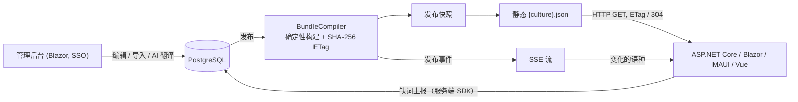

<div align="center">

# MASA.Lingua

**轻量级多语言平台：集中管理词条，发布为静态 JSON 产物，通过 SSE 让所有客户端热更新。**

[](LICENSE)
[](https://github.com/masastack/MASA.Lingua/actions/workflows/pr_run_test_ci.yml)
[](https://www.nuget.org/packages/MASA.Lingua.Core/)
[](global.json)

[English](README.md) | [简体中文](README.zh-CN.md)

</div>

---

MASA.Lingua 是一个翻译管理平台加一组客户端 SDK。译者在 Blazor 管理后台工作（可选 AI 辅助翻译）；客户端——ASP.NET Core、Blazor、MAUI、Vue 3 应用——通过普通 HTTP 读取带强 ETag 的翻译产物，并通过 Server-Sent Events 接收发布通知。

运行期不依赖平台：启动之后客户端读的是带版本化的静态 JSON。Lingua 服务短暂不可用时，应用照常渲染手头已有的译文。

## 特性

- **强 ETag 静态产物**——发布生成不可变的 `{culture}.json`，以 `ETag` + `Cache-Control: no-cache` 下发，未变化即 `304`。没有过期缓存，也没有「发布完成到客户端生效」的额外延迟。
- **SSE 热更新**——每条发布事件携带 `projectCode`、各语种 ETag 与 `versionHash`；客户端跳过未变化的语种，事件丢失时靠固定空闲对账兜底。
- **分层回退**——全局共享命名空间（`common` / `errors`）与项目命名空间合并；未发布的语种回退为源语种文案。
- **AI 辅助翻译**——通过 [Microsoft.Extensions.AI](https://learn.microsoft.com/dotnet/ai/conceptual-overview) 批量翻译（任何 OpenAI 兼容端点，如本地 Ollama），结果先过确定性校验再落库。
- **术语强制**——强制术语在词条编辑与发布两个关口校验，并给出合规报告。
- **确定性发布**——产物字节与 ETag 可复现：相同输入必得相同输出，服务重启后从数据库快照按字节还原线上版本。
- **缺词上报**——服务端 SDK 把缺失词条回传平台（凭项目写密钥鉴权）。
- **多端 SDK**——ASP.NET Core 的 `IStringLocalizer`、MASA Framework 的 `I18n.T` 桥接、Masa.Blazor 的 `T()`、.NET MAUI 的热更新 Localizer，以及带 `lingua-sync` CLI（拉取 / 推送 / 检查）的 Vue 3 适配器。

## 工作原理



## 包一览

| 包 | 目标框架 | 说明 |
|---|---|---|
| [`MASA.Lingua.Core`](https://www.nuget.org/packages/MASA.Lingua.Core/) | net8.0 / net10.0 | 领域模型、包编译器、JSON 转换器、确定性校验引擎 |
| [`MASA.Lingua.SDK.Abstractions`](https://www.nuget.org/packages/MASA.Lingua.SDK.Abstractions/) | net8.0 / net10.0 | 客户端契约、冻结内存存储、同步协议 |
| [`MASA.Lingua.SDK.AspNetCore`](https://www.nuget.org/packages/MASA.Lingua.SDK.AspNetCore/) | net8.0 / net10.0 | 基于 `{culture}.json` 的 `IStringLocalizer` 适配器，SSE + 轮询热更新 |
| [`MASA.Lingua.SDK.MasaI18n`](https://www.nuget.org/packages/MASA.Lingua.SDK.MasaI18n/) | net8.0 / net10.0 | 接入 MASA Framework `I18n.T` / `II18n<T>` 的桥接 |
| [`MASA.Lingua.SDK.MasaBlazor`](https://www.nuget.org/packages/MASA.Lingua.SDK.MasaBlazor/) | net8.0 / net10.0 | Masa.Blazor `T()` 集成 |
| [`MASA.Lingua.SDK.Maui`](https://www.nuget.org/packages/MASA.Lingua.SDK.Maui/) | net8.0 / net10.0 | .NET MAUI / Blazor Hybrid / WPF 客户端的 Localizer |
| [`@lingua/vue`](packages/lingua-vue) | Node >= 18 | Vue 3 + vue-i18n 适配器，附 `lingua-sync` CLI（pull / push / check） |

服务端本体（`MASA.Lingua.Server`，.NET 10）与 EF Core 存储不以包形式发布——请直接部署 Docker 镜像。

## 快速开始

> 完整走查见 [docs/quickstart.zh-CN.md](docs/quickstart.zh-CN.md)。管理后台需要 SSO 登录，但下面的步骤全部走匿名机器 API——不需要 SSO。

```bash
# 1. PostgreSQL（唯一支持的数据库）
docker run -d --name lingua-pg -e POSTGRES_PASSWORD=lingua -e POSTGRES_DB=lingua -p 5432:5432 postgres:16

# 2. 启动 Lingua 服务（本地运行；Auth__Authority 覆盖可跳过 MASA Stack 的 DCC/SSO 解析）
dotnet run --project src/MASA.Lingua.Server -- \
  Lingua__Database__ConnectionString="Server=localhost;Port=5432;User Id=postgres;Password=lingua;Database=lingua;" \
  Auth__Authority=https://sso.invalid \
  Auth__ClientId=local
```

```bash
# 3. 建项目、导入草稿、发布
curl -X POST http://localhost:62641/api/v1/projects/demo

curl -X POST "http://localhost:62641/api/v1/projects/demo/import-json?culture=en-US&publish=true" \
  -H "Content-Type: application/json" \
  -d '{"greeting": "Hello, {name}!"}'
```

```csharp
// 4. 在任意 ASP.NET Core 应用里消费（net8.0 / net10.0）
builder.Services.AddLinguaLocalization(options =>
{
    options.ServerEndpoint = "http://localhost:62641";
    options.ProjectCode = "demo";
});
```

空库首次启动会自动播种三个示例项目（`auth-web-staging`、`auth-sso-staging`、`shop-vue`），可直接体验。

## 各端接入矩阵

| 客户端类型 | 包 / 工具 | 热更新 |
|---|---|---|
| ASP.NET Core（MVC / Minimal API / Razor Pages） | `MASA.Lingua.SDK.AspNetCore` | SSE + 轮询兜底，自动 |
| MASA Framework I18n（`I18n.T`） | `MASA.Lingua.SDK.MasaI18n` | 发布后实时热更新，调用点零改动 |
| Masa.Blazor 前端 | `MASA.Lingua.SDK.MasaBlazor` | 与 MasaI18n 同宿主时共享 store、跟随 SSE 对账 |
| .NET MAUI / Blazor Hybrid / WPF | `MASA.Lingua.SDK.Maui` | 启动与回到前台时同步 |
| Vue 3 + vue-i18n | `@lingua/vue` | SSE + 轮询，`startHotUpdate()` |
| 构建期（CI 检查、批量导入导出） | `lingua-sync` CLI | — |

各端接入指南见 [docs/integration/README.md](docs/integration/README.md)。

## 部署要点

- **运行时**：服务端 .NET 10；数据库仅 PostgreSQL；**单实例**（发布缓存与 SSE 广播是进程内状态——横向扩展前必须先外置）。
- 管理后台**必须 HTTPS**（OIDC Cookie 带 `Secure` 标记）；在 ingress 终止 TLS 并设置 `ASPNETCORE_FORWARDEDHEADERS_ENABLED=true`。
- 机器读端点匿名且 CORS 全开——请部署在受控网段；写端点与管理后台是独立的访问控制。详见 [docs/deployment.zh-CN.md](docs/deployment.zh-CN.md)。

## 文档

- [快速开始](docs/quickstart.zh-CN.md)——从空库到一条已发布、已消费的译文
- [架构](docs/architecture.zh-CN.md)——组件与数据流
- [部署](docs/deployment.zh-CN.md)——生产清单：HTTPS、持久化、资源限制
- [接入指南](docs/integration/README.md)——各端 SDK 指南与经过验证的示例

## 参与贡献

欢迎贡献！开发环境搭建与 PR 流程见 [CONTRIBUTING.md](CONTRIBUTING.md)。请先阅读[社区行为准则](CODE_OF_CONDUCT.md)；漏洞报告见[安全策略](SECURITY.md)。

## 许可证

本项目基于 [Apache License 2.0](LICENSE) 开源。
