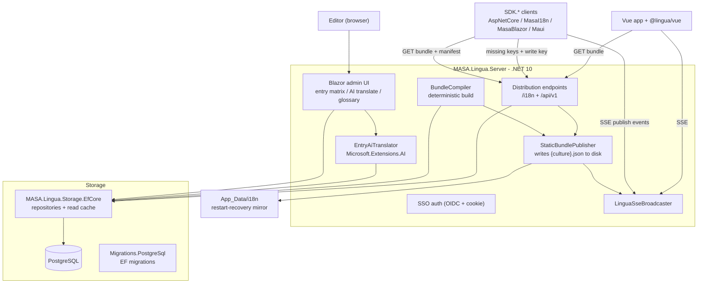
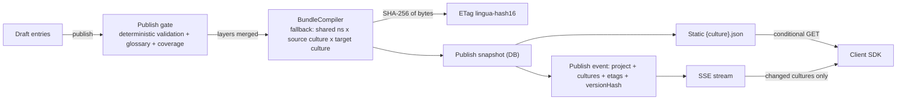

# Architecture

> [简体中文](architecture.zh-CN.md) · [Back to docs index](README.md)

## Components

## Projects

| Project | TFM | Role |
|---|---|---|
| `MASA.Lingua.Core` | net8.0; net10.0 | Domain model, bundle compiler, JSON converter, deterministic validation. Shared by server and client SDKs, therefore dual-target and restricted to net8-available APIs. |
| `MASA.Lingua.AI` | net10.0 | AI batch translation over `Microsoft.Extensions.AI` (any OpenAI-compatible endpoint). |
| `MASA.Lingua.Server` | net10.0 | Blazor admin UI, distribution endpoints, publishing, SSE broadcasting, AI orchestration. |
| `MASA.Lingua.Storage.EfCore` | net10.0 | EF Core repositories with a read cache, seeding, JSON column converters. |
| `MASA.Lingua.Storage.Migrations.PostgreSql` | net10.0 | EF migrations (PostgreSQL is the only supported database). |
| `SDK/*` (5 packages) | net8.0; net10.0 | Thin client adapters; hot update is implemented inside each client process. |

## Data flow: from edit to client

Key properties:

1. **Deterministic compilation** — [BundleCompiler](../src/MASA.Lingua.Core/Compilation/BundleCompiler.cs) merges layers in priority order (shared namespace source culture → shared namespace target culture → project source culture → project target culture), sorts entries ordinal, and serializes to canonical JSON. An entry's identity is its (namespace, key) pair compared **case-insensitively** ([LinguaKeys](../src/MASA.Lingua.Core/Domain/LinguaKeys.cs)) — storage enforces the same rule with `lower(...)` unique indexes — so a project entry overrides the shared one even if the casing differs, and the bundle carries the spelling the entry was first created with. The same input always produces byte-identical output, so the ETag (first 16 hex chars of the SHA-256) is stable across replicas, restarts and re-publishes of unchanged content.
2. **Restart recovery** — on boot the server restores published bundles from database snapshots (`FromPublishedBytes`), guaranteeing the ETags match what clients already cached.
3. **Layered fallback** — a translation without an approved value in the target culture falls back to the source culture text at compile time; clients never receive keys for published entries.

## Distribution contract

| Endpoint | Semantics |
|---|---|
| `GET /i18n/{project}/{culture}.json` | Published bundle; strong ETag + `Cache-Control: no-cache`; `304` when unchanged. `?format=flat` serves the flat variant of the same content (shared ETag — derived from a fingerprint covering both representations). |
| `GET /api/v1/bundles/{project}/{culture}` | Compatibility route for the same content. |
| `GET /api/v1/projects/{project}/manifest` | Version fingerprint, published cultures, default culture. 404 until the first publish. |
| `GET /api/v1/projects/{project}/glossary` | Effective glossary (global + project), ETagged. |
| `GET /api/v1/projects/{project}/export-zip` | **Current edit state** (including unpublished drafts), all cultures. |
| `GET /api/v1/stream?project={project}` | SSE: publish/rollback events, 15 s heartbeat, `retry: 3000`, `Last-Event-ID` catch-up of the latest publish per project. |
| `POST /api/v1/projects/{project}` | Idempotent project skeleton creation; returns the write key on creation. |
| `DELETE /api/v1/projects/{project}` | Cascading delete (entries, glossary, publish history); also evicts the project's in-memory bundle cache and removes its published files on disk. |
| `POST /api/v1/projects/{project}/import-json` | Draft import (or immediate publish with `publish=true`); 10 MB cap. |
| `POST /api/v1/telemetry/missing-keys` | Missing-key telemetry; requires the project write key (`X-Lingua-Key`); server-side SDKs only. |

**Access policy**: read endpoints are always anonymous. The write-style endpoints (project create / delete, `import-json`, `export-zip`) are anonymous by default — the intended deployment is a controlled network segment. As defence in depth, set `Lingua:Distribution:WriteApiKey` (use a long random value, inject it by environment variable, never commit it): those four endpoints then require a matching `X-Lingua-Key` header (`401` when missing, `403` when wrong). This shared key is separate from the per-project write key used by telemetry. The admin UI's "download all cultures" button is not affected — it uses the SSO-protected `GET /admin/projects/{project}/export-zip`. Project codes (the PM identity) double as the publish directory name, so they are restricted to ASCII letters, digits, `-` and `_` (1–64 characters) and anything else is rejected with `400`.

**SSE carries only "changed" signals, never content**: payloads contain project code, per-culture ETags and `versionHash`; clients always fetch content themselves. Losing, duplicating or reordering events therefore only affects latency, never correctness — and the .NET SDK additionally reconciles on an idle interval.

## Validation pipeline

Every import and publish runs [deterministic validation](../src/MASA.Lingua.Core/Validation/DeterministicTranslationValidator.cs):

- Placeholder consistency (`{name}` / `{0}` sets must match the source).
- Length constraints and HTML-safety flags.
- [Glossary compliance](../src/MASA.Lingua.Core/Publishing/GlossaryCompliance.cs) — mandatory terms must appear in translations.

Imports are recorded as "reviewed" with flagged issues; the publish gate is the hard stop that can block publishing with an explicit `publishBlockedReason`.

## Single-instance constraint

The publish cache, manifest statistics and SSE broadcast are **in-process state**. Deploying multiple replicas silently misbehaves: instance A publishes, instance B keeps serving stale bundles, and SSE clients on B never receive the event. Horizontal scaling requires first externalizing the publish cache and event broadcast (e.g. to Redis).
