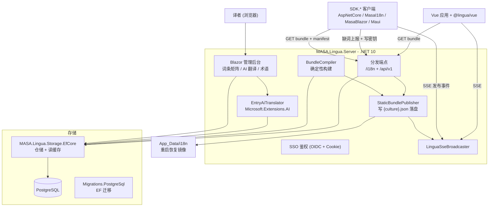
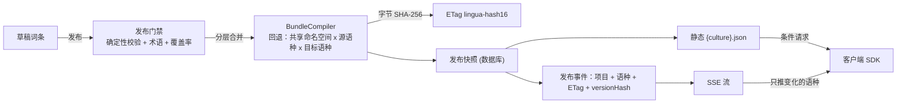

# 架构

> [English](architecture.md) · [返回文档目录](README.md)

## 组件

## 工程一览

| 工程 | TFM | 职责 |
|---|---|---|
| `MASA.Lingua.Core` | net8.0; net10.0 | 领域模型、包编译器、JSON 转换器、确定性校验。服务端与客户端 SDK 共用，因此双目标、只允许 net8 可用 API。 |
| `MASA.Lingua.AI` | net10.0 | 基于 `Microsoft.Extensions.AI` 的 AI 批量翻译（任意 OpenAI 兼容端点）。 |
| `MASA.Lingua.Server` | net10.0 | Blazor 管理后台、分发端点、发布、SSE 广播、AI 编排。 |
| `MASA.Lingua.Storage.EfCore` | net10.0 | EF Core 仓储（带读缓存）、种子数据、JSON 列转换器。 |
| `MASA.Lingua.Storage.Migrations.PostgreSql` | net10.0 | EF 迁移（数据库仅支持 PostgreSQL）。 |
| `SDK/*`（5 个包） | net8.0; net10.0 | 薄客户端适配器；热更新在各客户端进程内实现。 |

## 数据流：从编辑到客户端

关键性质：

1. **确定性编译**——[BundleCompiler](../src/MASA.Lingua.Core/Compilation/BundleCompiler.cs) 按优先级合并各层（共享命名空间源语种 → 共享命名空间目标语种 → 项目源语种 → 项目目标语种），词条按 Ordinal 排序后序列化为规范化 JSON。相同输入必得字节相同的输出，因此 ETag（SHA-256 前 16 个十六进制字符）跨副本、跨重启、对未变化内容重复发布都稳定。
2. **重启恢复**——服务启动时从数据库快照还原已发布 bundle（`FromPublishedBytes`），保证 ETag 与客户端已缓存的完全一致。
3. **分层回退**——目标语种没有「已批准」译文的词条在编译期回退为源语种文案；已发布词条的 key 不会下发到客户端。

## 分发契约

| 端点 | 语义 |
|---|---|
| `GET /i18n/{project}/{culture}.json` | 已发布 bundle；强 ETag + `Cache-Control: no-cache`；未变化返回 `304`。`?format=flat` 输出扁平变体（独立 ETag）。 |
| `GET /api/v1/bundles/{project}/{culture}` | 同一内容的兼容路由。 |
| `GET /api/v1/projects/{project}/manifest` | 版本指纹、已发布语种、默认语种。首次发布前 404。 |
| `GET /api/v1/projects/{project}/glossary` | 生效术语库（全局 + 项目），带 ETag。 |
| `GET /api/v1/projects/{project}/export-zip` | **当前编辑状态**（含未发布草稿）的全部语种。 |
| `GET /api/v1/stream?project={project}` | SSE：发布/回滚事件，15s 心跳，`retry: 3000`，`Last-Event-ID` 补发各项目最近一次发布。 |
| `POST /api/v1/projects/{project}` | 幂等创建项目骨架；新建时返回写密钥。 |
| `DELETE /api/v1/projects/{project}` | 级联删除（词条、术语、发布历史）。 |
| `POST /api/v1/projects/{project}/import-json` | 草稿导入（`publish=true` 时立即发布）；上限 10MB。 |
| `POST /api/v1/telemetry/missing-keys` | 缺词上报；需项目写密钥（`X-Lingua-Key`）；仅服务端 SDK。 |

**SSE 只承载「变了」的信号，不承载内容**：载荷含项目编码、各语种 ETag 与 `versionHash`；内容永远由客户端自己拉取。因此事件丢失、重复、乱序只影响延迟、不影响正确性——.NET SDK 另有空闲间隔对账兜底。

## 校验流水线

每次导入与发布都跑[确定性校验](../src/MASA.Lingua.Core/Validation/DeterministicTranslationValidator.cs)：

- 占位符一致性（`{name}` / `{0}` 集合必须与源文一致）。
- 长度约束与 HTML 安全标记。
- [术语合规](../src/MASA.Lingua.Core/Publishing/GlossaryCompliance.cs)——强制术语必须出现在译文中。

导入按「已审核」落库并只统计提示（FlaggedIssues）；发布门禁是硬关口，可以用明确的 `publishBlockedReason` 拦下发布。

## 单实例约束

发布缓存、manifest 统计与 SSE 广播都是**进程内状态**。多副本部署会静默出错：A 实例发布后，B 实例继续吐旧 bundle，且 B 上的 SSE 客户端永远收不到发布事件。横向扩展前必须先把发布缓存与事件广播外置（如 Redis）。
